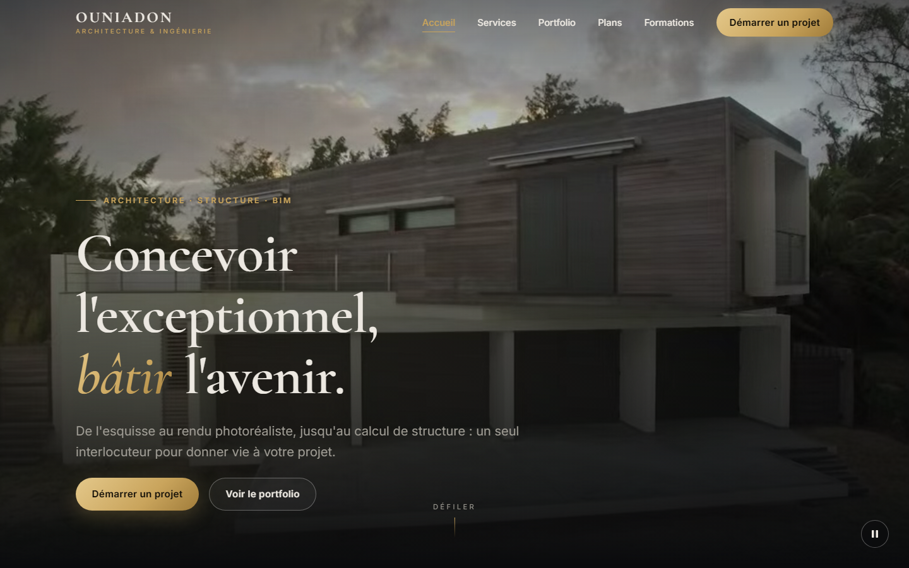

<!--
  Project : Architecture & Engineering Services
  Author  : OUNIADON HAIROULAH (ID: 411030513)
  File    : README.md
-->

# 🏛️ Architecture & Engineering Services

> A full-stack web application for an architecture & structural engineering studio:
> immersive portfolio, ready-to-build house plans, BIM software training, and a secure
> client-request system.

**Status:** ✅ Complete — academic project for *Web Applications Development* (تطوير تطبيقات الويب, course 2561).

📄 **Full project report:** [docs/PROJECT_REPORT.pdf](docs/PROJECT_REPORT.pdf)



## 🎯 Purpose

I am an architect and structural engineer with 13,000+ followers who know my photorealistic
3D renders. This website turns that audience into clients by letting visitors:

- 📐 request a **custom project** (architectural design, 3D visualization, structural study, BIM)
- 🏠 buy **ready-to-build plans** (villas, duplexes, apartment buildings)
- 🎓 enroll in **training programs**: Archicad, Lumion, Revit, Robot Structural Analysis

## 🧰 Tech stack

| Layer      | Technologies |
|------------|--------------|
| Frontend   | Semantic HTML5 · CSS3 (Flexbox & Grid only, no framework) · Mobile-first · Vanilla JavaScript (ES6+) |
| Backend    | PHP 8 (object-oriented) · PDO with prepared statements |
| Database   | MySQL / MariaDB (InnoDB, utf8mb4) |
| Tooling    | XAMPP · VS Code · Git |

## 🗄️ Database design

Normalized schema (3NF) using **class table inheritance** for the three request types:

```
clients (1) ──< requests (N)
                  ├── custom_project_details      (1–1)
                  ├── plan_purchase_details       (1–1) >── plans
                  └── training_enrollment_details (1–1) >── trainings
```

Highlights: named PK / FK / UNIQUE / CHECK constraints, `DECIMAL` for money, price snapshot
at purchase time, `ON DELETE RESTRICT` on catalog items, an overview view built with joins,
and a least-privilege database user (`SELECT`, `INSERT`, `UPDATE` only).

## 🛠️ Admin area (`/admin`)

Password-protected back office to manage incoming requests:
dashboard with key figures (`COUNT`/`SUM` aggregates), filters by type and status,
search by name or e-mail, detailed request view (joins), and status updates (`UPDATE`).

Create the admin account from the command line:

```bash
php database/create_admin.php <username> <password>
```

## 🔒 Security

| Threat | Protection |
|---|---|
| SQL injection | PDO prepared statements with native (non-emulated) prepares |
| XSS | `htmlspecialchars()` on every output, whitelist checks on URL parameters |
| CSRF | Random session token (`random_bytes`) checked with `hash_equals()` |
| Price tampering | Plan price read from the database, never trusted from the browser |
| Spam | Honeypot field + per-session rate limit (HTTP 429) |
| Partial writes | Client → request → details inserted in a single transaction |
| Data leaks | Credentials outside Git, `.htaccess` deny on `src/`, `config/`, `database/`, errors logged not displayed |
| Privilege abuse | Dedicated DB user limited to `SELECT`, `INSERT`, `UPDATE` |
| Password theft | Admin passwords stored as bcrypt hashes (`password_hash` / `password_verify`) |
| Brute force | Account locked for 15 min after 5 failed logins |
| Session hijacking | `session_regenerate_id()` on login, HttpOnly + SameSite cookies, 30-min idle timeout |
| Clickjacking | `X-Frame-Options: DENY` on admin pages |

## 📁 Project structure

```
├── index.html, portfolio.html, contact.php
├── assets/      css/, js/, images/, videos/
├── admin/       back office (login, dashboard, request detail)
├── api/         form handlers (PHP)
├── src/         PHP classes (Database, ClientRequest, Auth, …) – web access denied
├── config/      database credentials (not versioned)    – web access denied
├── database/    schema.sql, seed.sql, app_user.sql      – web access denied
└── docs/        project report
```

## ▶️ Run locally

1. Install [XAMPP](https://www.apachefriends.org/) and start **Apache** and **MySQL**.
2. Clone this repository into `C:\xampp\htdocs\`.
3. In phpMyAdmin, import `database/schema.sql`, then `database/seed.sql`,
   then `database/app_user.sql` (set your own password first).
4. Copy `config/config.example.php` to `config/config.php` and enter the same password.
5. Open `http://localhost/<folder-name>/` in your browser.

## 🗺️ Roadmap

- [x] Phase 1 — Development environment
- [x] Phase 2 — Database architecture
- [x] Phase 3 — Frontend (hero video, interactive portfolio, contact form)
- [x] Phase 4 — Backend (OOP PHP, secure inserts with PDO)
- [x] Phase 5 — Project report ([Markdown](docs/PROJECT_REPORT.md) · [PDF](docs/PROJECT_REPORT.pdf))

## 👤 Author

**Hairoulah OUNIADON** — Building Engineer & Data Scientist
[GitHub](https://github.com/ouniadonds-byte)
