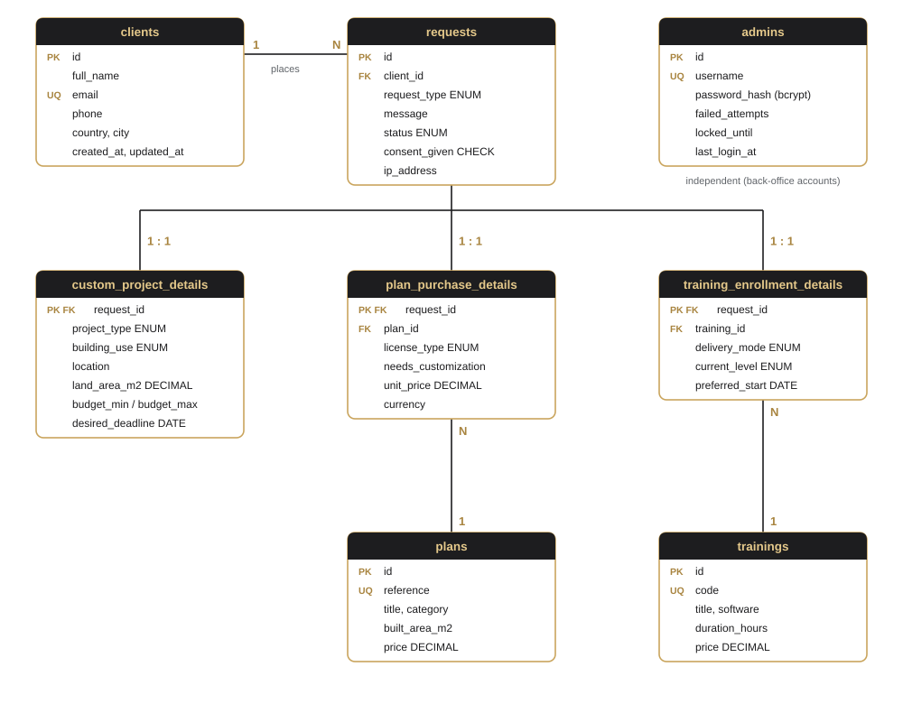
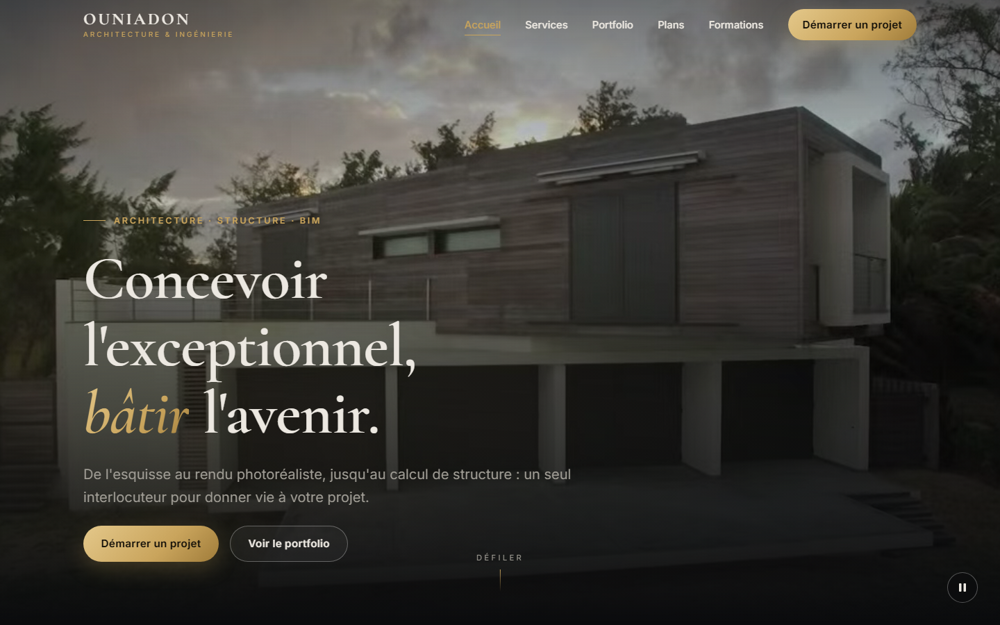
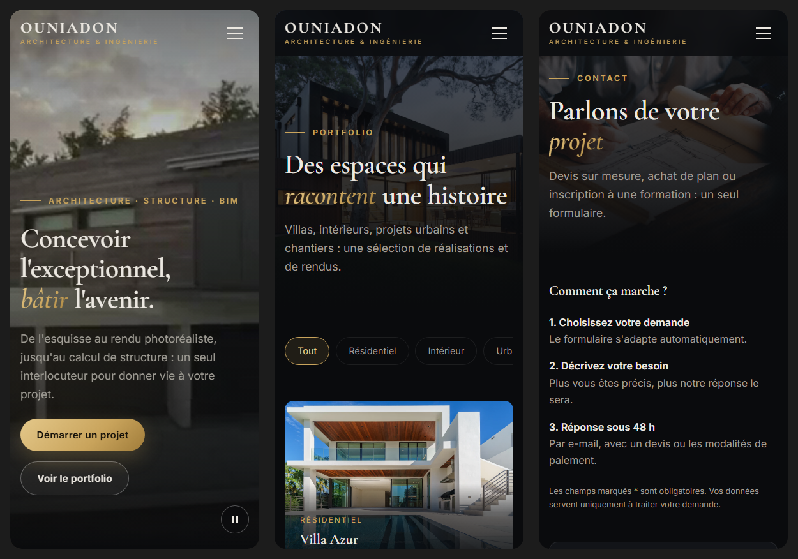
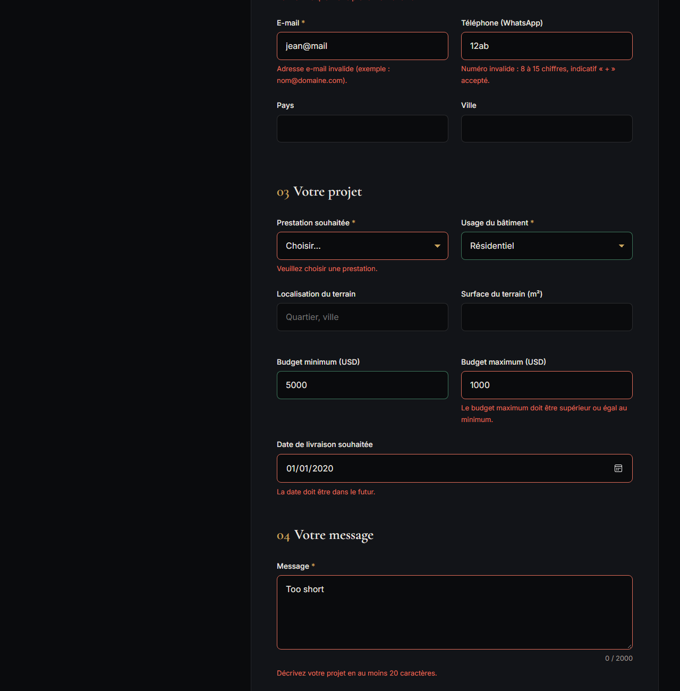
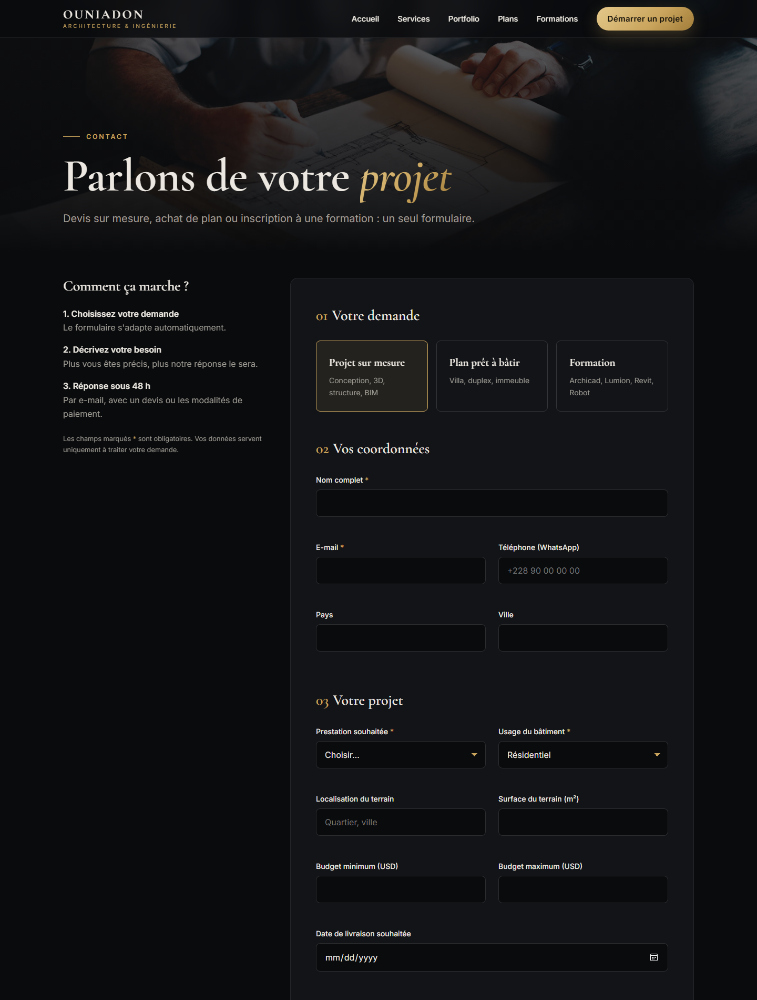
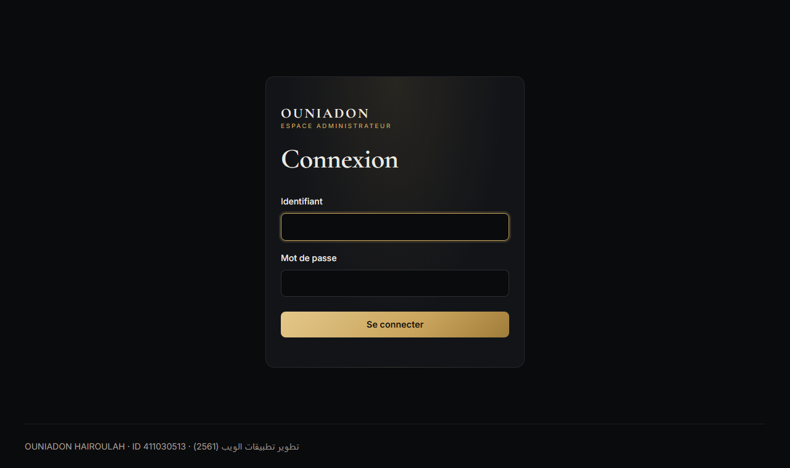
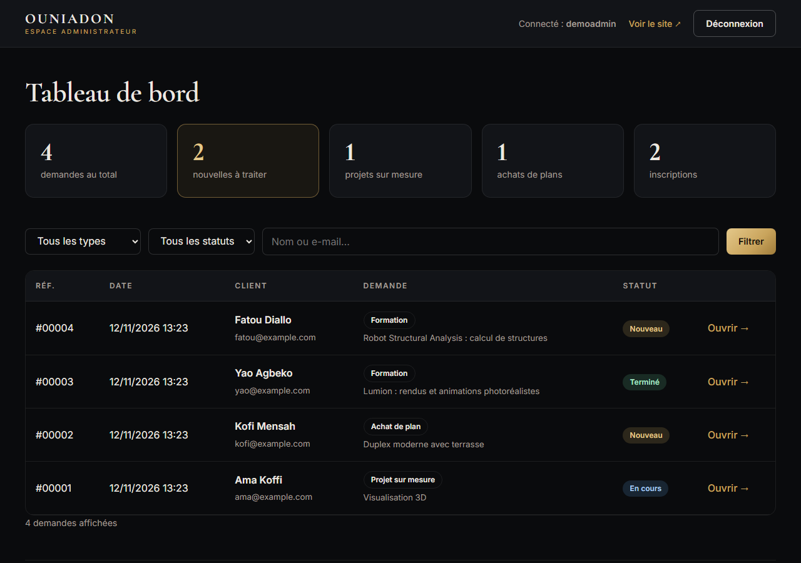
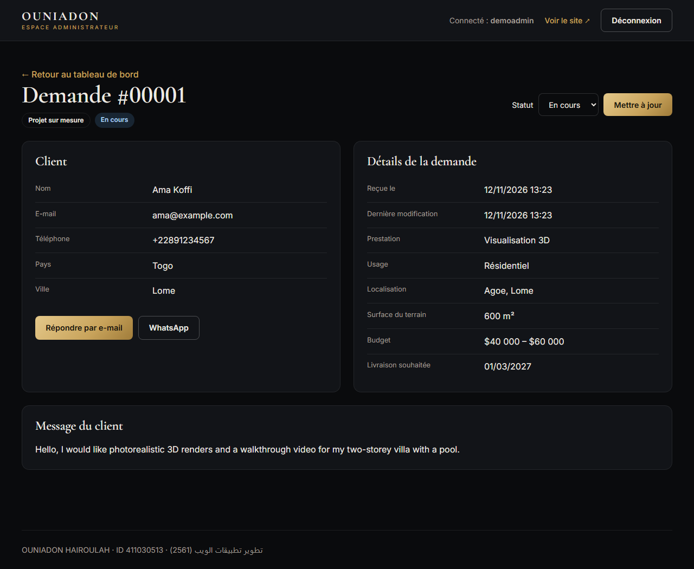

<!--
  Project : Architecture & Engineering Services
  Author  : OUNIADON HAIROULAH (ID: 411030513)
  File    : docs/PROJECT_REPORT.md
  Purpose : Final project report (source for the PDF presentation document)
-->

<div class="cover" style="text-align:center">
<p class="cover-uni"><strong>Islamic University of Madinah</strong><br>Computer Science &amp; Information Systems — Data Science track</p>
<p class="cover-course"><strong>تطوير تطبيقات الويب — Web Applications Development</strong><br>Course code: 2561</p>
<h1 class="cover-title">Architecture &amp; Engineering Services</h1>
<p class="cover-subtitle"><em>A Full-Stack Web Application for an Architecture and Structural Engineering Studio</em></p>
<p class="cover-people"><strong>Student:</strong> OUNIADON HAIROULAH<br><strong>Student ID:</strong> 411030513<br><br><strong>Professor:</strong> عمر عبد الرحيم ظاهر نوح</p>
<p class="cover-date"><strong>November 2026</strong><br>Source code: https://github.com/ouniadonds-byte/architecture-engineering-services</p>
</div>

<div style="page-break-after: always;"></div>

## Abstract

*Architecture & Engineering Services* is a full-stack web application built for an
architecture and structural engineering studio whose audience of more than 13,000
social-media followers is used to photorealistic 3D renders. The application turns this
audience into clients: visitors can explore an immersive portfolio, order ready-to-build
house plans, enroll in professional software training (Archicad, Lumion, Revit, Robot
Structural Analysis), or request a custom project. Every request is validated in the
browser and again on the server, then stored in a normalized MySQL/MariaDB database
through PDO prepared statements inside a transaction. A password-protected back office
lets the studio follow up on each request.

The project was built in five incremental phases and strictly follows the course
constraints: semantic HTML5, CSS3 with Flexbox and Grid only (no framework), a
mobile-first design, vanilla JavaScript (ES6+, event delegation, strict client-side
validation), object-oriented PHP, and SQL with prepared statements. It consists of about
5,400 lines of hand-written code across 30 source files, versioned with Git after each
phase.

<div style="page-break-after: always;"></div>

## Table of Contents

1. [Introduction](#1-introduction)
2. [Methodology](#2-methodology)
3. [Development Environment](#3-development-environment)
4. [System Architecture](#4-system-architecture)
5. [Database Design](#5-database-design)
6. [Front-End Development](#6-front-end-development)
7. [Back-End Development](#7-back-end-development)
8. [Admin Area](#8-admin-area)
9. [Security](#9-security)
10. [Testing and Validation](#10-testing-and-validation)
11. [Mapping to the Course Requirements](#11-mapping-to-the-course-requirements)
12. [Challenges and Lessons Learned](#12-challenges-and-lessons-learned)
13. [Conclusion and Future Work](#13-conclusion-and-future-work)
14. [Appendices](#14-appendices)

<div style="page-break-after: always;"></div>

## 1. Introduction

### 1.1 Context

I work as an architect and structural engineer: I design buildings, calculate their
structures and produce photorealistic 3D renders that I share with more than 13,000
followers on social media. These followers regularly ask for three things: custom
projects, ready-to-build plans, and training on the software I use every day.
Until now, these requests arrived scattered across private messages, with no structure
and no follow-up.

### 1.2 Problem statement

How can a small studio collect, structure and follow up on client requests through a
website that is visually as strong as its 3D renders, while remaining secure and built
only with the fundamental web technologies taught in this course?

### 1.3 Objectives

| # | Objective | Result |
|---|---|---|
| O1 | Create a premium, immersive visual experience ("wow" effect) | Full-screen video hero, dark theme with gold accents, scroll animations |
| O2 | Offer three request paths in a single form | Custom project, plan purchase, training enrollment |
| O3 | Validate all inputs strictly, on the client and on the server | 22 client-side rules, mirrored in a PHP validation class |
| O4 | Store the data in a normalized, constrained relational database | 8 tables + 1 view, PK/FK/UNIQUE/CHECK constraints |
| O5 | Protect the application against common web attacks | SQL injection, XSS, CSRF, brute force, clickjacking, tampering |
| O6 | Give the studio a tool to follow up on requests | Password-protected admin dashboard |
| O7 | Respect the course constraints strictly | No framework, Flexbox/Grid only, vanilla JS, OOP PHP, PDO |

### 1.4 Scope

The application runs locally on XAMPP. Online payment, e-mail notifications and
production deployment are outside the scope of this academic version and are listed as
future work (Chapter 13).

<div style="page-break-after: always;"></div>

## 2. Methodology

### 2.1 Incremental, phase-based approach

The project followed an **incremental methodology**: each phase produced a working,
tested increment, and the next phase started only after the previous one was validated.
This made every step easy to verify and gave a clean history to present.

| Phase | Content | Deliverables |
|---|---|---|
| 1 | Development environment | XAMPP, VS Code, Git; verification script |
| 2 | Database architecture | `schema.sql`, `seed.sql`, `app_user.sql` |
| 3 | Front-end | 3 pages, 3 style sheets, 3 scripts, optimized media |
| 4 | Back-end | 5 PHP classes, JSON API, database-driven form |
| 4b | Admin area | Authentication, dashboard, request detail, status updates |
| 5 | Report | This document |

### 2.2 Version control

Git was used from the first phase, with one commit per phase pushed to GitHub. Each
commit message describes the changes and carries the author's name and student ID.

| Commit | Date | Message |
|---|---|---|
| `d48dd5a` | 2026-11-11 | Phase 1 & 2: project structure and database schema |
| `bebdf43` | 2026-11-12 | Phase 3: frontend (home, portfolio, contact form) |
| `b58110d` | 2026-11-12 | Phase 4: OOP PHP backend with secure PDO inserts |
| `be75f13` | 2026-11-12 | Phase 4b: password-protected admin area |

Secrets are never versioned: `config/config.php`, which holds the database password, is
listed in `.gitignore`, and only a template (`config.example.php`) is published.

### 2.3 Coding conventions

- Every source file starts with a header comment with the author's name and student ID.
- Code identifiers are in English; comments are in French (the language of the course work).
- Database identifiers use `snake_case`; constraints are named with prefixes
  (`pk_`, `fk_`, `uq_`, `ck_`) so that error messages are readable.
- PHP files use `declare(strict_types=1)` to enforce strict typing.

<div style="page-break-after: always;"></div>

## 3. Development Environment

### 3.1 Tools

| Tool | Version | Role |
|---|---|---|
| XAMPP | 8.2.12 | Local server stack |
| Apache | 2.4.58 | Web server |
| PHP | 8.2.12 | Server-side language (with the `pdo_mysql` driver) |
| MariaDB | 10.4.32 | Relational database (MySQL-compatible) |
| phpMyAdmin | 5.2.1 | Database administration |
| Visual Studio Code | 1.145 | Code editor (Intelephense, Prettier, Markdown PDF) |
| Git / GitHub | 2.55 | Version control and publication |
| Microsoft Edge | — | Testing, DevTools device mode, automated screenshots |
| FFmpeg | — | Video compression for the hero section |

### 3.2 Verification

A test script checked that Apache, PHP and the PDO connection to MariaDB all worked
before any development started:

```php
$pdo = new PDO('mysql:host=localhost;charset=utf8mb4', 'root', '', [
    PDO::ATTR_ERRMODE => PDO::ERRMODE_EXCEPTION,
]);
$version = $pdo->query('SELECT VERSION()')->fetchColumn();
echo "PDO connection to MySQL/MariaDB successful ($version)";
```

<div style="page-break-after: always;"></div>

## 4. System Architecture

### 4.1 Three-tier architecture

```
┌─────────────────────────── PRESENTATION (browser) ───────────────────────────┐
│  HTML5 pages  ·  CSS3 (Flexbox / Grid, mobile-first)  ·  Vanilla JS (ES6+)   │
│  index.html      portfolio.html      contact.php      admin/*.php            │
└───────────────────────────────┬───────────────────────────────────────────────┘
                                │ HTTP: GET pages · POST form (fetch → JSON)
┌───────────────────────────────▼──────────── APPLICATION (Apache + PHP 8.2) ──┐
│  api/submit-request.php  →  CSRF · honeypot · rate limit · validation        │
│  src/  Database (PDO singleton) · ClientRequest · Catalog · Csrf             │
│        Auth · RequestRepository · Labels · bootstrap · helpers               │
└───────────────────────────────┬───────────────────────────────────────────────┘
                                │ PDO, prepared statements, transactions
┌───────────────────────────────▼──────────────────── DATA (MariaDB 10.4) ─────┐
│  archi_services: clients · requests · 3 detail tables · plans · trainings    │
│                  admins · view v_requests_overview                           │
└───────────────────────────────────────────────────────────────────────────────┘
```

### 4.2 Project structure

```
archi-services/
├── index.html, portfolio.html, contact.php     ← public pages
├── assets/
│   ├── css/      base.css · layout.css · components.css · admin.css
│   ├── js/       main.js · portfolio.js · form-validation.js
│   ├── images/   portfolio/ · plans/ · trainings/   (WebP)
│   └── videos/   hero-hd.webm · hero-hd.mp4 · hero-sd.mp4 · poster
├── api/          submit-request.php             ← JSON endpoint
├── admin/        login · index · request · logout · _layout
├── src/          PHP classes                    ← web access denied (.htaccess)
├── config/       config.php (not versioned)     ← web access denied
├── database/     SQL scripts + create_admin.php ← web access denied
└── docs/         this report + screenshots
```

Three folders contain an `.htaccess` file with `Require all denied`: the browser can
never download the PHP classes, the credentials or the SQL scripts directly. Only the
entry points (pages, API, admin) are public.

### 4.3 Request flow

```
Visitor            form-validation.js        submit-request.php       ClientRequest        MariaDB
   │  fills form          │                         │                       │                 │
   │─────────────────────▶│ 22 rules, live feedback │                       │                 │
   │                      │── fetch POST (FormData)▶│ CSRF? honeypot? rate? │                 │
   │                      │                         │──── validate() ──────▶│ SELECT plan price│
   │                      │                         │                       │◀────────────────│
   │                      │                         │──── save() ──────────▶│ BEGIN           │
   │                      │                         │                       │ upsert client   │
   │                      │                         │                       │ INSERT request  │
   │                      │                         │                       │ INSERT details  │
   │                      │                         │                       │ COMMIT          │
   │                      │◀── 201 JSON + reference │                       │                 │
   │◀── success message ──│                         │                       │                 │
```

<div style="page-break-after: always;"></div>

## 5. Database Design

### 5.1 Requirements analysis

The studio receives three kinds of requests that share common data (who, when, message,
status) but each has its own fields:

| Request type | Specific data |
|---|---|
| Custom project | Service type, building use, location, land area, budget range, deadline |
| Plan purchase | Chosen plan, license type, customization, price at purchase time |
| Training enrollment | Chosen training, delivery mode, current level, preferred start date |

### 5.2 Design choice: Class Table Inheritance

Storing all fields in a single `requests` table would leave most columns empty (`NULL`)
for every row. Instead, the schema uses **Class Table Inheritance**: the common fields
live in a parent table `requests`, and each request type has its own **one-to-one**
detail table whose primary key is also a foreign key to `requests`.

### 5.3 Entity–relationship diagram



### 5.4 Data dictionary (main tables)

**`requests`**

| Column | Type | Constraint | Purpose |
|---|---|---|---|
| `id` | `INT UNSIGNED` | PK, `AUTO_INCREMENT` | Request reference |
| `client_id` | `INT UNSIGNED` | FK → `clients(id)` `ON DELETE CASCADE` | Owner of the request |
| `request_type` | `ENUM(…)` | `NOT NULL` | Which detail table applies |
| `message` | `TEXT` | `NULL` | Free text from the client |
| `status` | `ENUM('new','in_progress','completed','cancelled')` | default `'new'` | Follow-up in the admin area |
| `consent_given` | `BOOLEAN` | `CHECK (consent_given = 1)` | Data-processing consent |
| `ip_address` | `VARCHAR(45)` | `NULL` | 45 = maximum length of an IPv6 address |
| `created_at`, `updated_at` | `TIMESTAMP` | automatic | Audit dates |

**`plan_purchase_details`**

| Column | Type | Constraint | Purpose |
|---|---|---|---|
| `request_id` | `INT UNSIGNED` | PK + FK → `requests` `CASCADE` | 1:1 link |
| `plan_id` | `INT UNSIGNED` | FK → `plans` `ON DELETE RESTRICT` | A plan that was ordered cannot be deleted |
| `license_type` | `ENUM('single_build','multi_build')` | `NOT NULL` | |
| `needs_customization` | `BOOLEAN` | default `FALSE` | |
| `unit_price` | `DECIMAL(10,2)` | `CHECK (unit_price >= 0)` | **Price snapshot** at purchase time |

### 5.5 Good practices applied

| Practice | Example |
|---|---|
| Precise types | `DECIMAL(10,2)` for money (never `FLOAT`), `VARCHAR(254)` for e-mail (RFC 5321 maximum), `ENUM` for closed lists |
| Named constraints | `ck_cpd_range CHECK (budget_min <= budget_max)` gives a readable error |
| Referential actions | `CASCADE` on dependent rows, `RESTRICT` on catalog items |
| Historical accuracy | `unit_price` keeps the price paid, even if the catalog price changes later |
| Indexes | `(request_type, status)` and `created_at` for the admin filters |
| Unicode | `utf8mb4` / `utf8mb4_unicode_ci` (accents, Arabic, emoji) |
| Transactional engine | InnoDB for all tables (transactions, crash recovery, foreign keys) |
| Least privilege | The application connects as `archi_app`, limited to `SELECT, INSERT, UPDATE` |

The schema is in **third normal form**: every non-key attribute depends on the whole key
and only on the key (client data is not repeated in each request, catalog data is not
repeated in each order).

### 5.6 Overview view

A view joins the six tables so that the admin dashboard reads a single, simple source:

```sql
CREATE VIEW v_requests_overview AS
SELECT r.id AS request_id, r.created_at, r.request_type, r.status,
       c.full_name, c.email, c.phone,
       COALESCE(cpd.project_type, p.title, t.title) AS subject,
       r.message
FROM requests r
INNER JOIN clients c                       ON c.id = r.client_id
LEFT  JOIN custom_project_details cpd      ON cpd.request_id = r.id
LEFT  JOIN plan_purchase_details ppd       ON ppd.request_id = r.id
LEFT  JOIN plans p                         ON p.id = ppd.plan_id
LEFT  JOIN training_enrollment_details ted ON ted.request_id = r.id
LEFT  JOIN trainings t                     ON t.id = ted.training_id;
```

### 5.7 Least-privilege database account

```sql
CREATE USER IF NOT EXISTS 'archi_app'@'localhost' IDENTIFIED BY '••••••••';
GRANT SELECT, INSERT, UPDATE ON archi_services.* TO 'archi_app'@'localhost';
```

Even if an attacker found a flaw in the application, this account cannot `DELETE`,
`DROP` or `ALTER` anything. This was verified (see Chapter 10).

<div style="page-break-after: always;"></div>

## 6. Front-End Development

### 6.1 Pages

| Page | Content |
|---|---|
| `index.html` | Video hero, animated key figures, 4 services, featured projects, 3 plans, 4 trainings, process, call to action |
| `portfolio.html` | 14 projects in a mosaic, 5 category filters, `<dialog>` lightbox with keyboard navigation |
| `contact.php` | One form, three paths that adapt to the selected request type |



### 6.2 Semantic HTML5

The pages use HTML5 elements for their meaning, not their appearance: `header`, `nav`,
`main`, `section`, `article`, `figure`/`figcaption`, `footer`, `fieldset`/`legend`,
`ol` for the process steps, and the native `dialog` element for the lightbox.
Accessibility is built in: a "skip to content" link, `aria-label`, `aria-expanded`,
`aria-pressed`, `aria-live` regions for status messages, `aria-describedby` linking
each field to its error message, and visible focus styles.

### 6.3 CSS3: Flexbox and Grid only, mobile-first

No framework (no Bootstrap, no Tailwind) was used. The CSS is split into three files:

| File | Content |
|---|---|
| `base.css` | Design tokens (CSS variables), reset, typography, buttons, accessibility |
| `layout.css` | Container, sections, header, navigation, footer |
| `components.css` | Hero, cards, portfolio, lightbox, form, scroll animations |

**Mobile-first**: base styles target phones; `min-width` media queries enrich the
layout for larger screens.

```css
.services-grid { display: grid; gap: var(--space-md); }             /* phone: 1 column */

@media (min-width: 768px)  { .services-grid { grid-template-columns: repeat(2, 1fr); } }
@media (min-width: 1024px) { .services-grid { grid-template-columns: repeat(4, 1fr); } }
```

**Grid** is used for two-dimensional layouts (card grids, portfolio mosaic with
`grid-auto-flow: dense`, form grid); **Flexbox** for one-dimensional alignment
(navigation, buttons, card footers). Fluid sizes use `clamp()`, and design tokens
centralize colors, fonts and spacing:

```css
:root {
    --clr-bg:   #0a0b0d;   /* dark background */
    --clr-gold: #c9a45c;   /* gold accent     */
    --clr-blue: #5b9be0;   /* blue accent     */
    --fs-h1: clamp(2.6rem, 1.6rem + 4.5vw, 5.5rem);
}
```



### 6.4 The video hero

| Optimization | Implementation |
|---|---|
| Autoplay allowed by browsers | `<video autoplay loop muted playsinline>` |
| Three files | 480p MP4 for phones (`media="(max-width: 767px)"`), WebM and MP4 for larger screens |
| Lightweight | 16-second clip compressed with FFmpeg: 0.9 MB (mobile) to 2.2 MB |
| Instant display | `poster` image (49 KB) preloaded with `<link rel="preload">` |
| Readability | Dark gradient overlay above the video |
| Accessibility | Pause/play button (WCAG 2.2.2); `prefers-reduced-motion` keeps the still image |
| Battery | The video pauses when it leaves the screen (`IntersectionObserver`) |

### 6.5 Vanilla JavaScript (ES6+)

| File | Responsibilities |
|---|---|
| `main.js` | Mobile menu, header on scroll (`requestAnimationFrame`), scroll reveal and animated counters (`IntersectionObserver`), video control |
| `portfolio.js` | Category filters and lightbox, using event delegation |
| `form-validation.js` | `FormValidator` class: dynamic sections, 22 validation rules, `fetch` submission |

ES6+ features used: `const`/`let`, arrow functions, template literals, destructuring,
classes, `async`/`await`, optional chaining `?.`, nullish coalescing `??`, `Set`,
spread `[...]`, numeric separators (`1_000_000`), Unicode regular expressions (`/\p{L}/u`).

### 6.6 Event delegation

Instead of attaching a listener to each of the 5 filter buttons and 14 project buttons,
**a single listener is attached to the parent container**; `event.target.closest()`
identifies which element was clicked. This uses less memory and keeps working for
elements added later.

```javascript
filterBar.addEventListener('click', (event) => {
    const button = event.target.closest('[data-filter]');
    if (!button) return;                       // click outside a button: ignore

    filterBar.querySelectorAll('[data-filter]').forEach((btn) => {
        btn.setAttribute('aria-pressed', String(btn === button));
    });
    applyFilter(button.dataset.filter);
});
```

The form uses the same principle: one `input`, one `change` and one `focusout` listener
handle every field. `focusout` is used instead of `blur` because it **bubbles**, which
is what makes delegation possible.

### 6.7 Strict client-side validation

The form has the `novalidate` attribute, so the browser's default bubbles are replaced
by custom French messages. The rules are centralized in one object, one function per field:

```javascript
budget_max: (value, form) => {
    if (!value) return '';
    const max = Number(value);
    const min = Number(form.elements.budget_min.value);
    if (max < 0) return 'Le budget ne peut pas être négatif.';
    if (form.elements.budget_min.value && max < min)
        return 'Le budget maximum doit être supérieur ou égal au minimum.';
    return '';
},
```

| Feature | Detail |
|---|---|
| Live feedback | A field is checked when the user leaves it, then on every keystroke |
| Cross-field rules | Maximum budget ≥ minimum budget |
| Context rules | Message mandatory (20 characters) only for a custom project |
| Dates | Past dates refused (local time) |
| Unicode names | `/^[\p{L}][\p{L}\s'’.-]*[\p{L}.]$/u` accepts accents and all alphabets |
| Hidden sections | Fields of inactive sections are `disabled`: neither validated nor sent |
| Anti-spam | Invisible honeypot field |
| Accessibility | `aria-invalid`, messages linked with `aria-describedby`, focus on the first error |



<div style="page-break-after: always;"></div>

## 7. Back-End Development

### 7.1 Object-oriented design

| Class | Responsibility | OOP concepts |
|---|---|---|
| `Database` | Single shared PDO connection | **Singleton**, private constructor, static properties and methods |
| `ClientRequest` | Server-side validation and transactional insert | Encapsulation (private data/methods), class constants, `match` |
| `Catalog` | Read plans and trainings | **Dependency injection** (constructor property promotion) |
| `Csrf` | Anti-CSRF token | Static utility class, class constant |
| `Auth` | Admin login, lockout, session | Encapsulation, static checks |
| `RequestRepository` | All admin SQL queries | **Repository** pattern |
| `Labels` | French labels for ENUM codes | Class constants, static method |

All classes are `final`, use strict types, and are loaded automatically by an autoloader
registered in `src/bootstrap.php`:

```php
spl_autoload_register(static function (string $class): void {
    $file = __DIR__ . '/' . $class . '.php';
    if (is_file($file)) {
        require $file;
    }
});
```

### 7.2 The PDO connection (Singleton)

```php
final class Database
{
    private static ?PDO $connection = null;

    private function __construct() {}           // "new Database()" is forbidden

    public static function getConnection(): PDO
    {
        if (self::$connection === null) {
            self::$connection = new PDO($dsn, $user, $password, [
                PDO::ATTR_ERRMODE            => PDO::ERRMODE_EXCEPTION,
                PDO::ATTR_DEFAULT_FETCH_MODE => PDO::FETCH_ASSOC,
                PDO::ATTR_EMULATE_PREPARES   => false,   // real server-side prepares
            ]);
        }
        return self::$connection;
    }
}
```

`ATTR_EMULATE_PREPARES => false` makes PDO use **real prepared statements**: the SQL
query and the data are sent to the server separately, so data can never be interpreted
as SQL.

### 7.3 Server-side validation

The JavaScript validation can be bypassed (developer tools, direct requests to the API),
so `ClientRequest::validate()` checks everything again: whitelists identical to the SQL
`ENUM` values, Unicode regular expressions, `filter_var()` for e-mails and numbers,
impossible dates (e.g. February 31st) detected by re-formatting, and the existence of
the chosen plan or training in the database.

The price of a plan is **read from the database**, never taken from the browser:

```php
$stmt = $this->pdo->prepare('SELECT id, price, currency FROM plans WHERE id = :id AND is_active = 1');
$stmt->execute([':id' => $planId]);
$plan = $stmt->fetch();
```

### 7.4 Transactional insert

Saving a request writes to three tables. A transaction guarantees **all or nothing**:

```php
public function save(?string $ipAddress): int
{
    $this->pdo->beginTransaction();
    try {
        $clientId  = $this->upsertClient();                   // 1. clients
        $requestId = $this->insertRequest($clientId, $ipAddress); // 2. requests
        $this->insertDetails($requestId);                     // 3. detail table
        $this->pdo->commit();
        return $requestId;
    } catch (Throwable $e) {
        $this->pdo->rollBack();                               // nothing is kept
        throw $e;
    }
}
```

A returning client (same e-mail, protected by a `UNIQUE` key) is reused instead of being
duplicated, thanks to an "upsert":

```sql
INSERT INTO clients (full_name, email, phone, country, city)
VALUES (:full_name, :email, :phone, :country, :city)
ON DUPLICATE KEY UPDATE id = LAST_INSERT_ID(id),
                        full_name = VALUES(full_name),
                        phone = COALESCE(VALUES(phone), phone)
```

### 7.5 The JSON API

`api/submit-request.php` receives the form (sent with `fetch`) and always answers in
JSON with a meaningful HTTP status code:

| Code | Meaning | When |
|---|---|---|
| `201 Created` | Request saved | Valid submission; the reference number is returned |
| `403 Forbidden` | Missing or wrong CSRF token | Forged request |
| `405 Method Not Allowed` | Not a POST | Direct access in the browser |
| `422 Unprocessable Entity` | Invalid data | Errors returned field by field and displayed under each field |
| `429 Too Many Requests` | Too frequent | Less than 30 s since the last submission |
| `500 Internal Server Error` | Unexpected error | Details written to the server log, never shown to the visitor |

### 7.6 Database-driven form

`contact.php` reads the plans and trainings from the database (class `Catalog`), so the
form always matches the catalog. If the database is unreachable, the page still displays
with a clear message instead of crashing. Links such as
`contact.php?type=plan_purchase&plan=2` pre-select a request type and a plan; the URL
parameters are checked against a whitelist or converted to integers before use.



<div style="page-break-after: always;"></div>

## 8. Admin Area

The public site only **writes** to the database. The admin area completes the
application by **reading and updating** the data, and demonstrates authentication with
PHP sessions.

| Page | Function | SQL |
|---|---|---|
| `admin/login.php` | Login form | `SELECT` + `UPDATE` (attempt counter) |
| `admin/index.php` | Key figures, filters, search, list | `COUNT`/`SUM`, view, dynamic `WHERE`, `LIKE` |
| `admin/request.php` | Full request detail, status change | `INNER JOIN`, `UPDATE` |
| `admin/logout.php` | Logout (POST + CSRF only) | — |







**Dynamic filters without SQL injection.** The `WHERE` clause is built from the selected
filters, but values are always bound parameters, and the `LIKE` wildcards typed by the
user are escaped:

```php
if ($query !== '') {
    $like = '%' . addcslashes($query, '%_\\') . '%';
    $conditions[] = '(full_name LIKE :q1 OR email LIKE :q2)';
    $params[':q1'] = $like;
    $params[':q2'] = $like;
}
```

**Admin accounts** are created from the command line only
(`php database/create_admin.php <username> <password>`); passwords are stored as bcrypt
hashes produced by `password_hash()`.

<div style="page-break-after: always;"></div>

## 9. Security

| Threat | Protection | Where |
|---|---|---|
| SQL injection | PDO prepared statements, native prepares, whitelists | All classes |
| Cross-site scripting (XSS) | `htmlspecialchars()` on every output (`e()` helper), `textContent` in JS | Pages, admin, JS |
| Cross-site request forgery (CSRF) | 64-character random session token (`random_bytes`), compared with `hash_equals()` | `Csrf`, form, admin |
| Price tampering | Price read from the database | `ClientRequest` |
| Spam and bots | Honeypot field + one submission per 30 s (HTTP 429) | API |
| Partial writes | Transaction with rollback | `ClientRequest::save()` |
| Password theft | bcrypt hashes (`password_hash` / `password_verify`) | `Auth`, `admins` |
| Brute force | Account locked for 15 minutes after 5 failures; same message for unknown user and wrong password | `Auth` |
| Session fixation / theft | `session_regenerate_id()` at login; HttpOnly, SameSite and strict-mode cookies; 30-minute idle timeout | `bootstrap`, `Auth` |
| Clickjacking | `X-Frame-Options: DENY` | Admin |
| Information leaks | Errors logged, not displayed; credentials outside Git; `.htaccess` deny on `src/`, `config/`, `database/` | Configuration |
| Privilege abuse | Database account limited to `SELECT, INSERT, UPDATE` | `app_user.sql` |

<div style="page-break-after: always;"></div>

## 10. Testing and Validation

Every phase was tested before being committed. Tests were run with `curl` (HTTP level),
with automated scripts in a headless browser (user level), and directly in the database.

### 10.1 Database (Phase 2)

| Test | Expected | Result |
|---|---|---|
| Run `schema.sql` and `seed.sql` | 7 tables (8 after adding `admins`), 1 view, 4 trainings, 3 plans | ✅ |
| Insert a training with a duration of 0 | Refused by `ck_trainings_duration` | ✅ |
| Client → request → details transaction, read through the view | One correct row | ✅ |
| Delete a plan that has been ordered | Refused by `fk_ppd_plan` (`RESTRICT`) | ✅ |
| `archi_app` runs `DELETE` / `DROP` | Refused (least privilege) | ✅ |

### 10.2 Front-end (Phase 3)

| Test | Result |
|---|---|
| PHP and JavaScript syntax (`php -l`, `node --check`) | ✅ no errors |
| Rendering at 1440 px and at a real width of 390 px | ✅ |
| Form with 8 deliberate errors | ✅ 8 errors detected, each with its own message |
| Switching request type disables the hidden sections | ✅ |
| `contact.php?type=<script>` | ✅ neutralized |
| Direct access to `database/schema.sql` | ✅ 403 Forbidden |

### 10.3 Back-end API (Phase 4)

| # | Test | Expected | Result |
|---|---|---|---|
| T1 | `GET` on the API | 405 | ✅ |
| T2 | `POST` without CSRF token | 403 | ✅ |
| T3 | 9 invalid fields | 422 with 9 messages | ✅ |
| T4 | Forged `plan_id=999` | 422 | ✅ |
| T5 | Valid plan purchase with forged `unit_price=1` | 201; price stored = **650.00** (from the database) | ✅ |
| T6 | Immediate second submission | 429 | ✅ |
| T7 | Message containing `Robert'); DROP TABLE clients;--` | 201; stored as plain text; all tables intact | ✅ |
| T8 | Valid training enrollment | 201 | ✅ |
| T9 | Same e-mail in upper case | Existing client reused | ✅ |
| T10 | Real submission from the browser | Row created in the database | ✅ |

### 10.4 Admin area (Phase 4b)

| Test | Result |
|---|---|
| `/admin/` without being logged in | ✅ redirected to the login page |
| Unknown user and wrong password | ✅ identical generic message |
| 5 wrong passwords, then the correct one | ✅ account locked for 15 minutes |
| Password stored in the database | ✅ bcrypt hash (`$2y$10$…`) |
| Search `' OR 1=1 --` | ✅ no results (no injection) |
| Status change without CSRF token | ✅ refused |
| Admin page loaded inside an `iframe` | ✅ blocked (`X-Frame-Options`) |
| `create_admin.php` opened in a browser | ✅ 403 Forbidden |

All test data was deleted afterwards (`ON DELETE CASCADE` removed the requests and
details of the deleted test clients automatically).

<div style="page-break-after: always;"></div>

## 11. Mapping to the Course Requirements

| Course requirement | Implementation | Files |
|---|---|---|
| **Chapters 1–9 — Semantic HTML5** | Structural elements, forms with `fieldset`/`legend`, `dialog`, ARIA attributes | `index.html`, `portfolio.html`, `contact.php` |
| **CSS3 without framework** | No Bootstrap or Tailwind; custom properties, `clamp()`, transitions, keyframe animations | `assets/css/*.css` |
| **Flexbox and Grid only** | Grid for two-dimensional layouts, Flexbox for alignment; no floats or positioning hacks for layout | `layout.css`, `components.css` |
| **Mobile-first design** | Base styles for phones, `min-width` breakpoints at 768 px and 1024 px; tested at 390 px | All CSS |
| **Vanilla JavaScript ES6+** | Classes, arrow functions, destructuring, template literals, `async`/`await`, `?.`, `??` | `assets/js/*.js` |
| **Event delegation** | One listener for all filters, one for all projects, one per event type for the form | `portfolio.js`, `form-validation.js`, `main.js` |
| **Strict client-side validation** | 22 rules, regular expressions, cross-field and context rules, live feedback | `form-validation.js` |
| **Chapter 12 — PHP (object-oriented)** | 7 classes, constructors, encapsulation, static members, Singleton, dependency injection, Repository, autoloading, sessions | `src/*.php`, `admin/*.php` |
| **Chapter 14 — SQL** | `CREATE TABLE` with PK/FK/UNIQUE/CHECK, `INSERT`, `SELECT` with `JOIN`, aggregates, view, `UPDATE`, transactions, user privileges | `database/*.sql`, `src/*.php` |
| **Prepared statements with PDO** | Every query with user data uses `prepare()` + `execute()` with bound parameters | `ClientRequest`, `Auth`, `RequestRepository`, `Catalog` |
| **Author identification** | Header comment with name and ID in every source file | All files |

<div style="page-break-after: always;"></div>

## 12. Challenges and Lessons Learned

| Challenge | Solution | Lesson |
|---|---|---|
| **Corrupted MariaDB system tables.** During a database test, a temporary server process did not stop cleanly; ending it abruptly corrupted the Aria-engine system tables, and the `GRANT` for the application account silently failed. | Diagnosis with `CHECK TABLE`, backup of the files, repair with `aria_chk` and `REPAIR TABLE`, restoration of the lost privileges. | Always stop the database properly. This also justified the choice of **InnoDB** (transactional, with crash recovery) for all project tables, which were not affected. |
| **Video weight.** The source clip was 55 s and 18 MB. | Trimmed to 16 s, sound removed, compressed with FFmpeg to H.264/VP9, plus a 480p version for phones. | Media optimization matters as much as code for perceived quality. |
| **Headless browser minimum width.** Automated screenshots at 390 px looked broken. | Testing inside 390 px-wide `iframe`s showed the real mobile rendering was correct. | Check that the testing tool is not the cause before "fixing" the code. |
| **`hidden` attribute ignored on SVG icons.** The reset `svg { display: block }` overrode it. | Global rule `[hidden] { display: none !important; }`. | CSS resets can have side effects on HTML semantics. |
| **Old-style numerals.** The display font drew "1" like "I". | `font-variant-numeric: lining-nums`. | Typography details affect the readability of data. |
| **Admin pages blank in an `iframe`.** | Expected: proof that `X-Frame-Options: DENY` works. | Some "bugs" are the security working. |

<div style="page-break-after: always;"></div>

## 13. Conclusion and Future Work

### 13.1 Conclusion

The project meets all its objectives. The application offers a premium visual experience
consistent with the studio's 3D renders, three request paths in a single adaptive form,
strict validation on both sides, a normalized and constrained database, protection against
the most common web attacks, and an admin area to follow up on requests. It respects every
constraint of the course: semantic HTML5, CSS3 with Flexbox and Grid only, a mobile-first
design, vanilla JavaScript with event delegation, object-oriented PHP and SQL with PDO
prepared statements.

Beyond the course requirements, the project showed how the fundamentals combine into a
real product: each layer (browser, PHP, database) validates and protects in its own way,
and none relies on the others alone.

### 13.2 Future work

| Improvement | Technology |
|---|---|
| Replace the placeholder media with my own Lumion renders and videos | FFmpeg (commands in `assets/CREDITS.md`) |
| E-mail notification for each new request | PHPMailer + SMTP |
| Online payment for plans and trainings | Payment gateway API |
| Deployment with a domain name and HTTPS | Shared hosting or VPS, Let's Encrypt |
| Pagination and CSV export in the admin area | `LIMIT`/`OFFSET`, `fputcsv()` |
| Bilingual site (French / Arabic, right-to-left) | `lang`/`dir` attributes, CSS logical properties |
| Automated tests | PHPUnit, browser automation |

<div style="page-break-after: always;"></div>

## 14. Appendices

### Appendix A — Installation guide

1. Install XAMPP and start **Apache** and **MySQL** from the XAMPP Control Panel.
2. Clone the repository into `C:\xampp\htdocs\`.
3. In phpMyAdmin → **Import**: `database/schema.sql`, then `database/seed.sql`,
   then `database/app_user.sql` (after setting a strong password in the file).
4. Copy `config/config.example.php` to `config/config.php` and enter the same password.
5. Create the admin account:
   `C:\xampp\php\php.exe database\create_admin.php <username> <password>`
6. Open `http://localhost/archi-services/` (site) and `http://localhost/archi-services/admin/` (admin).

### Appendix B — Source files

| Area | Files | Lines |
|---|---|---|
| HTML / PHP pages | `index.html`, `portfolio.html`, `contact.php` | 1,014 |
| CSS | `base.css`, `layout.css`, `components.css`, `admin.css` | 2,035 |
| JavaScript | `main.js`, `portfolio.js`, `form-validation.js` | 612 |
| PHP classes | `src/` (9 files) | 910 |
| API and admin | `api/submit-request.php`, `admin/` (5 files) | 496 |
| Database | 4 SQL scripts + `create_admin.php` | 336 |
| **Total** | **30 files** | **≈ 5,400** |

### Appendix C — Media credits

The images and the video are temporary placeholders, to be replaced by the author's
own renders.

| Media | Source | License |
|---|---|---|
| Hero video (16-second excerpt, re-encoded) | Mixkit — "Modern house on the beach" | Mixkit Stock Video Free License |
| Portfolio, plan and training images | Unsplash (cropped, converted to WebP) | Unsplash License |

### Appendix D — References

- MDN Web Docs — HTML, CSS and JavaScript reference: https://developer.mozilla.org
- PHP Manual — PDO, sessions, password hashing: https://www.php.net/manual
- MariaDB Knowledge Base — SQL statements, InnoDB, Aria: https://mariadb.com/kb
- OWASP Cheat Sheet Series — SQL injection, XSS, CSRF, authentication: https://cheatsheetseries.owasp.org
- W3C — Web Content Accessibility Guidelines (WCAG) 2.2: https://www.w3.org/TR/WCAG22/
